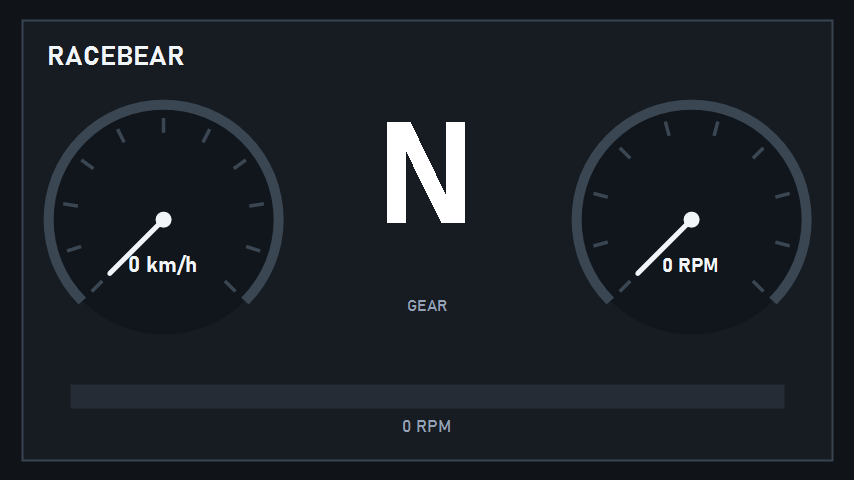

# 界面参考与素材边界

SDK 不要求第三方复制 SimRacebear。页面组织以
[前端 UI 规范](RaceBearSDK_FRONTEND_UI_SPEC.md)为准，
业务以[服务合同](RaceBearSDK_SERVICE_CONTRACTS.md)为准。
术语可从 [glossary.csv](glossary.csv)读取简体、繁体与英文建议译文。

## 实际仪表渲染

下图由本包 `examples/dashboard_render` 通过 SDK 的
`render_package_frame` 输出，再从同一 DIB 保存。854×480，离线零输入；
不是游戏实时遥测，也不是整个 Win32 窗口截图。

构建示例后执行 `RaceBearDashboardRender.exe` 可查看模板/页面下拉、
导入动作和渲染状态；`--snapshot <bmp>` 可重复生成帧。
内置资源须完整部署到 DLL 旁，不能只复制本图代替实际渲染。

## 可运行控制面板参考

`examples/RaceBearMotionStudio` 是公开 Win32 源码，侧栏切换以下 17 页。
它展示合同调用，不承诺每一项 SDK 能力已有完整产品页面。

| 页面 | 参考实现位置 |
|---|---|
| 总览、授权、日志和诊断 | `src/pages/StatusPages.cpp` |
| 游戏和遥测 | `src/pages/GamePage.cpp` |
| 动感平台 | `src/pages/PlatformPage.cpp` |
| 动态滤波、运动增强、震动、风感、安全带 | `src/pages/EffectsPages.cpp` |
| 输出、串口、自定义游戏、功能插件 | `src/pages/HardwarePages.cpp` |
| CAN 状态、外部数据源、系统与循环 | `src/pages/SettingsPages.cpp` |

RGB 页完整流程另见 [RGB 工作流](RaceBearSDK_RGB_WORKFLOW.md)，
配置方案可运行 `examples/cpp/profile_packages` 验证。
MotionStudio 震动选择器使用 Haptic 的 Count/Name，语义仍是 Dynamic 同名配置。

本轮自动桌面工具启动 MotionStudio 和仪表示例窗口均超时，未采集到
17 页窗口截图。该项保留待补；不能用设计示意图冒充实测截图。
目前已验证两配置编译、离线服务调用和上面的实际渲染帧，未验证全部页面的交互。

## 图标与许可

包内不含 SimRacebear 专有图标/品牌资源的再分发授权。第三方可使用自行取得许可的
图标库，采用通用添加、删除、复制、上下移、连接和保存图标，并配工具提示与可访问名称。
DashboardAssets 是仪表运行资源，不是控制面板图标素材包。
不应从官方程序、截图或缓存提取图标作为自己的产品素材。
